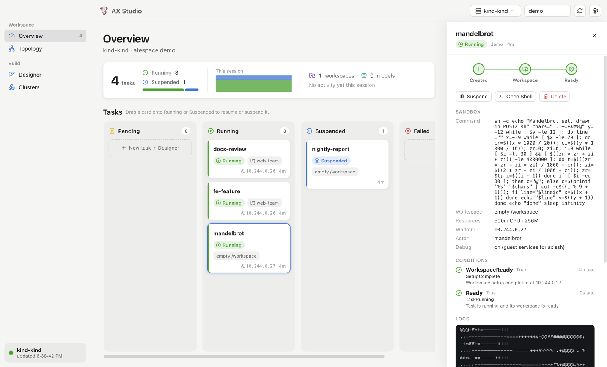
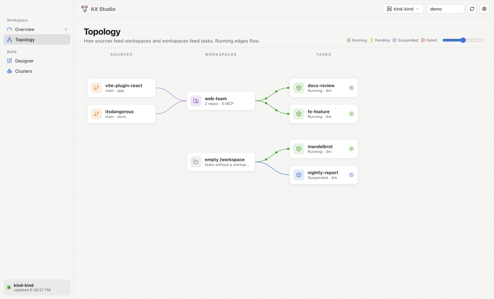
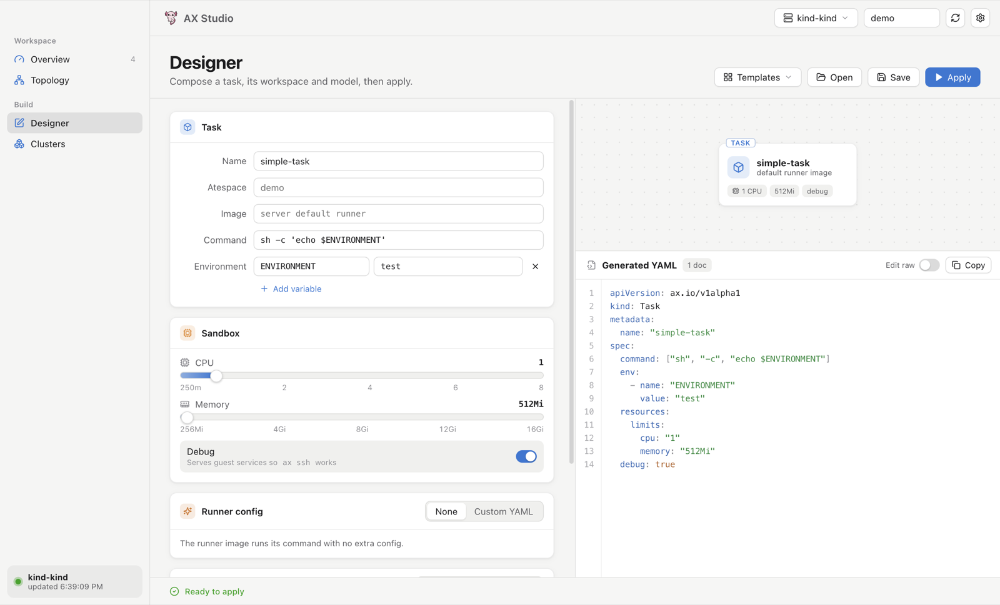
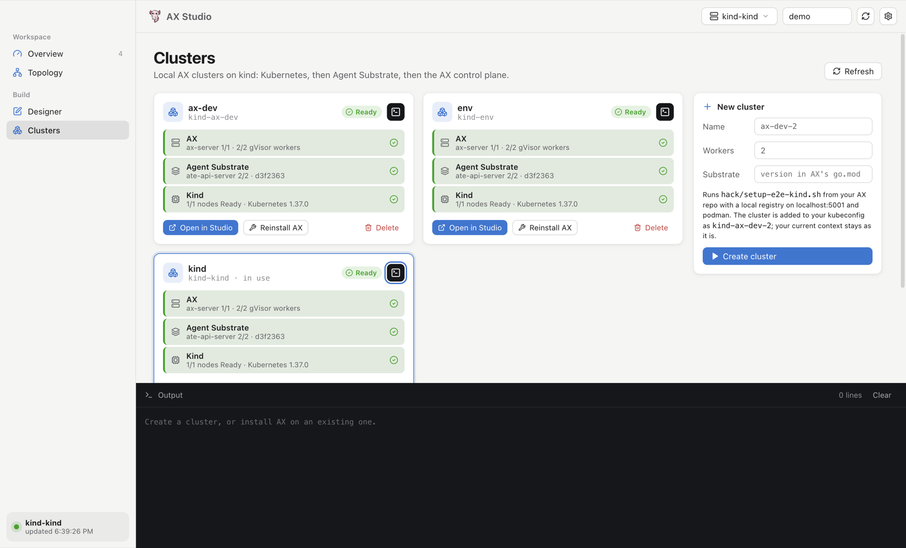
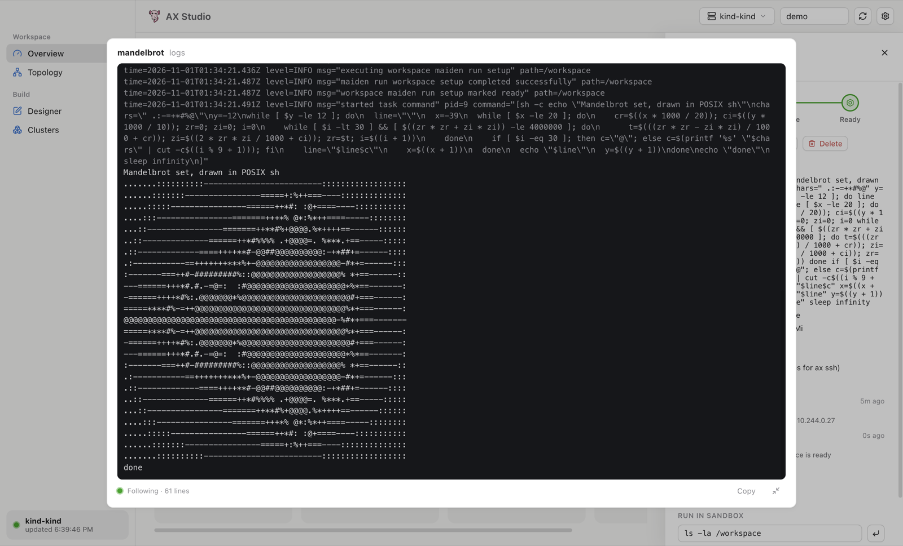

# AX Studio

A cross-platform desktop app for [AX](../ax): design tasks, watch them run, and
create local AX clusters. Built with Electron + React + TypeScript
and packaged as a native app for macOS, Windows and Linux.



| Section | What it does |
|---|---|
| **Overview** | A one-line digest (task count, phase breakdown, a this-session sparkline, workspaces and models, latest activity) above the task board: kanban by phase. Drag a card to Running/Suspended to resume/suspend; the inspector shows conditions and follows the task's logs, with shell and delete. |
| **Topology** | Sources → workspaces → tasks graph; running edges animate. |
| **Designer** | Form + live composition diagram + generated YAML (or raw edit). Templates, open/save, apply. |
| **Clusters** | Create, inspect and delete local AX clusters on kind: each shows its Kind, Agent Substrate and AX layers. Install or reinstall AX, open a cluster in Studio, or click its terminal icon for the commands to import its kubectl context and use it with kubectl and ax. |

## Screenshots

| | |
|---|---|
|  **Topology** |  **Designer** |
|  **Clusters** |  **Task logs**, expanded |

The app shells out to the `ax` CLI (and `kubectl`, `make`, `go`, `podman`/`docker`
to create clusters). It passes `--context` on every call and gives cluster setup a
temporary single-context `KUBECONFIG`, so it never changes your global ax or
kubectl context.

## Develop

```sh
npm install
npm run dev         # hot-reloading app
npm run typecheck
```

`npx electron . --section=clusters` opens the built app (`npm run build`) on a
given section. To refresh the README screenshots without the window taking
focus, render off-screen:

```sh
npx electron . --section=clusters --cluster=ax-dev --delay=7000 --screenshot=docs/screenshots/clusters.png
```

`--context=<name>` picks the AX context and `--task=<name>` opens that task's
inspector.

Task logs come from the Agent Substrate worker pods in `ax-system`: the app
follows them with `kubectl logs` and keeps the task's `guest` container lines
from the last 24 hours. They're only available on Kubernetes contexts.

## Package

```sh
npm run dist:mac    # dist/AX Studio-<v>-<arch>.dmg and -mac.zip
npm run dist:win    # NSIS installer + zip
npm run dist:linux  # AppImage, .deb, tar.gz
```

Build each OS on that OS (or in CI). macOS builds are unsigned
(`mac.identity: null` in `electron-builder.yml`); set an identity to sign and notarize.

The icon is the AX axolotl (`~/ax/assets/axel.svg`). To regenerate it on macOS:

```sh
swift scripts/make-icon.swift ~/ax/assets/axel.svg build-resources/icon.icns   # also writes icon.png
```

## Clusters

Creating a cluster (or installing AX on an existing kind cluster) runs the AX
repo's `hack/setup-e2e-kind.sh` with `KIND_CLUSTER_NAME`, `AX_WORKER_REPLICAS`
and, optionally, `SUBSTRATE_REF`. The script creates the kind cluster and a local
registry on `localhost:5001`, installs Agent Substrate at the version AX is built
against, deploys a gVisor WorkerPool, and builds and deploys AX. The script writes
its kubeconfig to `.tmp/kubeconfig-<name>`; the app then merges `kind-<name>` into
your kubeconfig, keeping its current context and saving a `.ax-studio.bak` backup.
Reinstalling AX recreates its Postgres, so existing tasks and workspaces are lost.

On machines with podman but no docker, the app puts a small `docker` shim in
front of PATH and sets `KIND_EXPERIMENTAL_PROVIDER=podman`. The shim
(`src/main/docker-shim.sh`) maps `buildx build --push` and `buildx imagetools
inspect` onto podman manifests and skips TLS for the local registry.

## Portability notes

- **PATH:** GUI apps don't inherit your terminal's PATH, so on macOS and Linux the app reads it
  from your login shell (`$SHELL -ilc`) at startup.
- **Windows:** cluster setup needs a POSIX shell. Install Git for Windows; the app uses its
  `bash`, plus `make` and `go`. "Open shell" uses Windows Terminal if present,
  otherwise `cmd`.
- **Linux:** "Open shell" tries `x-terminal-emulator`, gnome-terminal, konsole,
  xfce4-terminal, kitty, alacritty, then xterm.
